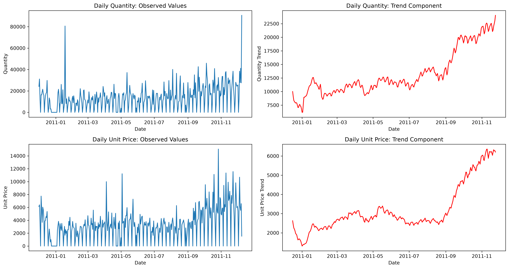
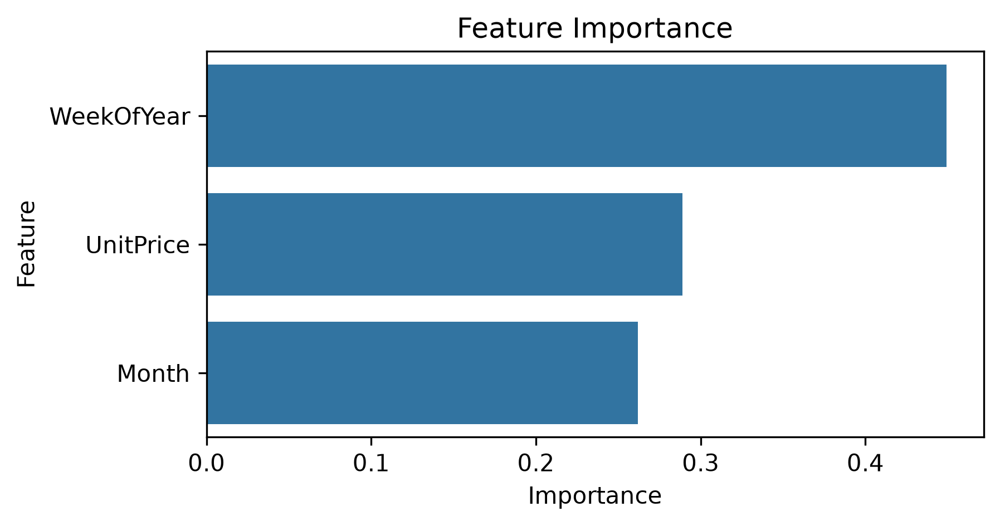
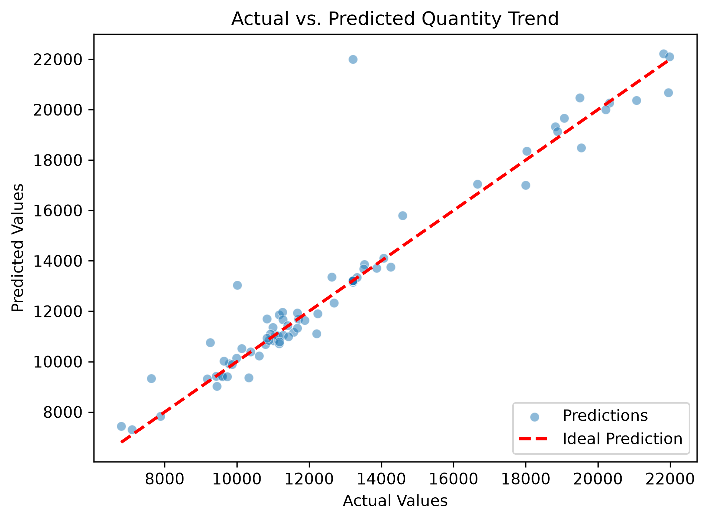
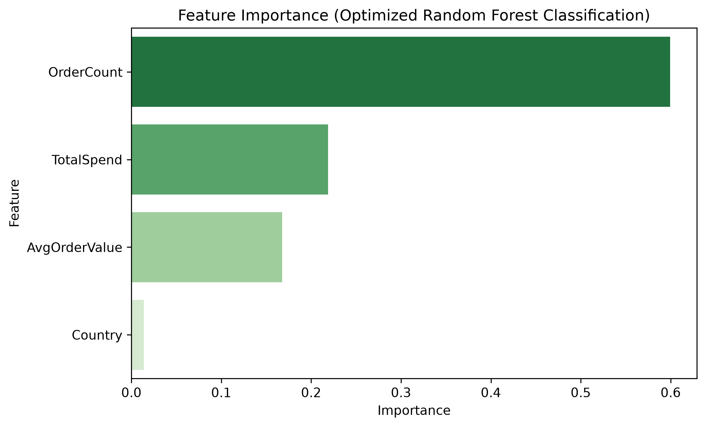
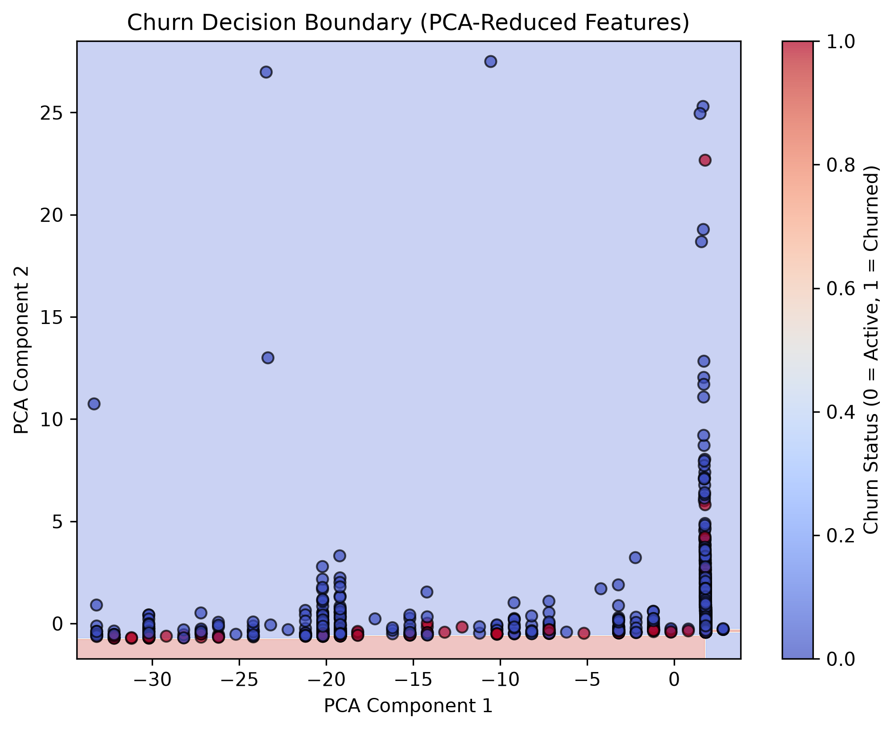
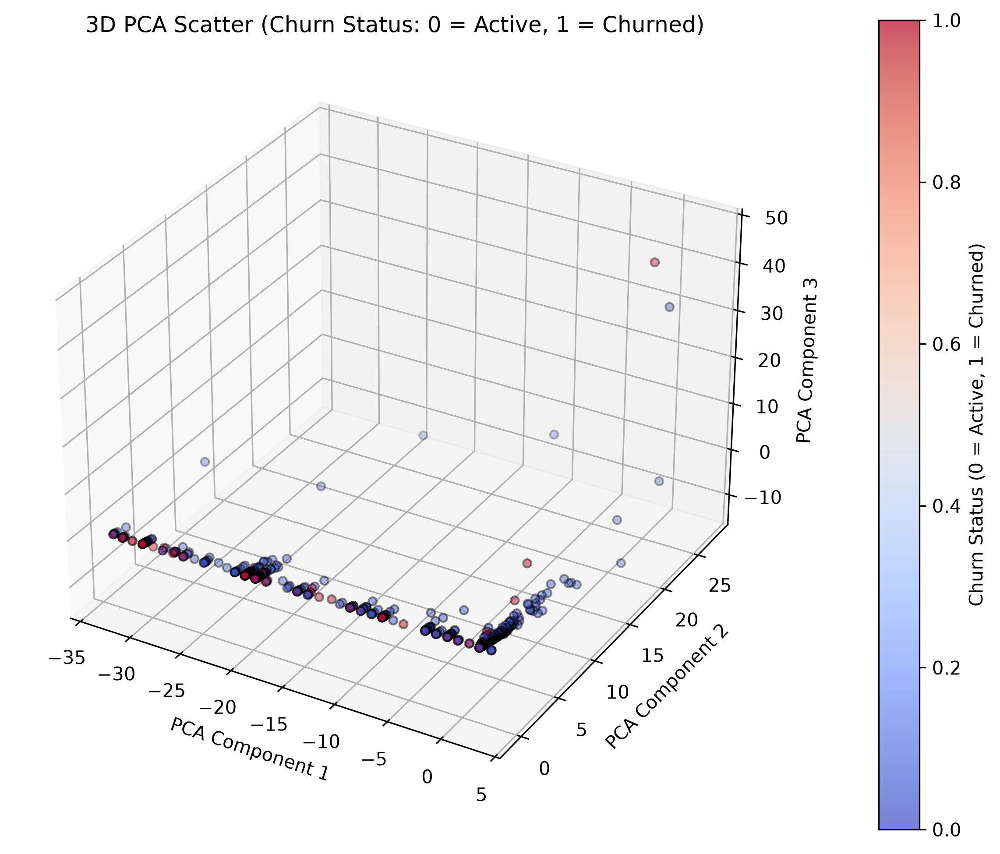
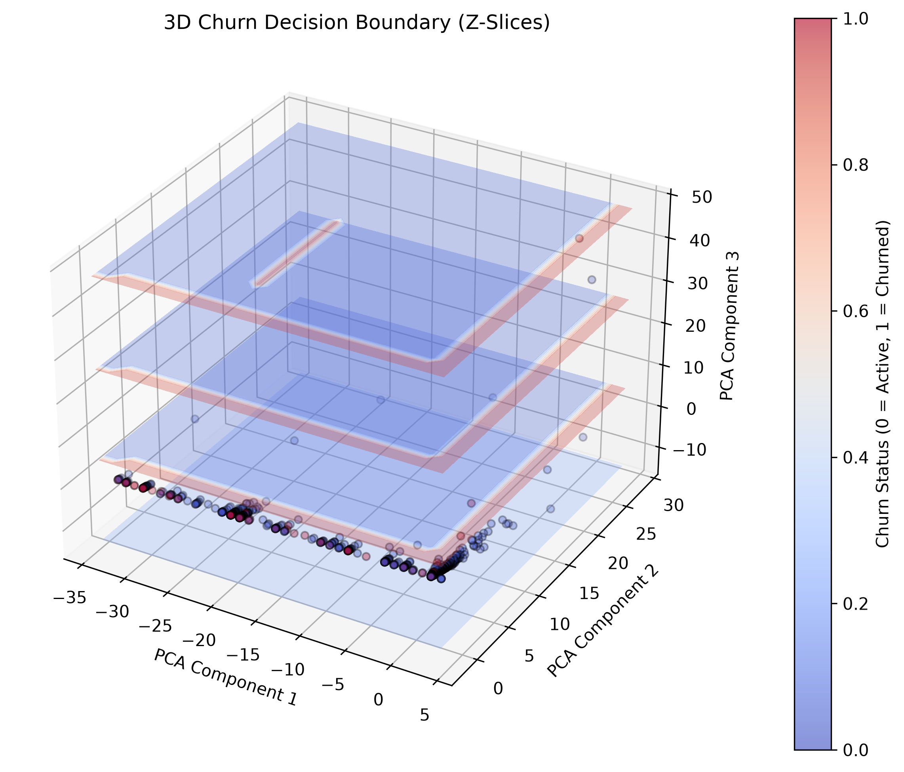

# Regression and Classification Trials for a Supply Chain Management Case

In this project, we apply the Random Forest algorithm to both regression and classification problems. Our focus is on a manufacturing company with distribution warehouses in different cities. This company sells its products to dealers, meaning the customers are the dealers who purchase products from the company.

## 1. Task Descriptions

### Regression Task
- **Target Variable:** **Purchase Quantity Trend (Quantity_Trend)**
- **Objective:**  
  To predict the total sales quantity made to dealers based on the sales data from distribution warehouses in different cities. This allows determining which city's warehouse has higher sales, enabling strategy formulation accordingly.
  
  Specifically, the goal is to predict the trend component obtained from the seasonal decomposition of the daily Quantity (number of products purchased) data. This way, the general trend in sales quantity can be analyzed to make future predictions.

### Classification Task
- **Target Variable:** **Dealer Churn (Churn)** (1: Dealer stopped purchasing, 0: Dealer continues purchasing)
- **Objective:**  
  To predict whether dealers will make future purchases based on their past purchasing data. This allows taking preventive measures for dealers at high risk of churn.

## 2. Dataset and Variables

The dataset used is adapted from online retail sales data from 2010-2011. However, in our scenario:
- **City:**  
  The "Country" variable in the dataset now represents the cities where the manufacturer distributes its products. Each row indicates that the sale was made from a distribution warehouse in a specific city.
- Other main columns:
  - **InvoiceNo:** Invoice number (unique)
  - **StockCode:** Product code
  - **Description:** Product name
  - **Quantity:** Number of products purchased
  - **InvoiceDate:** Transaction date
  - **UnitPrice:** Unit price of the product
  - **CustomerID:** Unique ID of the dealer

### Data Preprocessing
- Records with missing dealer (CustomerID) information were removed.
- Negative or zero values in Quantity and UnitPrice were excluded.

## 3. Feature Engineering

### Regression Model
- **Daily Totals:**  
  The dataset was reorganized to calculate daily totals (resample('D')) by selecting only numerical columns.

- **Seasonal Decomposition:**  
  - The Quantity and UnitPrice columns were subjected to seasonal decomposition with 30-day periods.
  - As a result of the decomposition, the trend component obtained for Quantity was determined as the target variable for the model.

- **City (Distribution Warehouse):**  
  The City variable represents the manufacturer's distribution warehouses in different cities. It is included in the model as a categorical variable after being numerically encoded.  
  *Why?* This allows the model to learn sales trends in different cities and enables region-based performance analysis.

### Classification Model
- **Encoding Categorical Variables:**  
  The Country column was converted to numerical form using LabelEncoder.

- **Customer-Level Aggregation:**
  The following metrics were calculated for each customer (CustomerID):
  - TotalSpend: Total spending (sum of TotalPrice)
  - OrderCount: Number of unique invoices (number of purchases)
  - AvgOrderValue: Average invoice value
  - Country: Country of the customer (encoded)
  - LastPurchase: Date of the last purchase

- **Defining Churn:**  
  - Using the latest date in the dataset as a reference, the difference between each customer's last purchase date and the reference date was calculated.
  - Customers who had not made a purchase for more than 180 days were labeled as churn (1), otherwise as not churn (0).

## 4. Model Training and Evaluation

The variables and target variable were split into 80% training and 20% testing for both models.

### Regression Model
- **Model:** Random Forest Regressor
- **Target:** Quantity Trend (Trend component obtained from seasonal decomposition of daily total Quantity data)
- **Variables Used:**  
  - Raw values: UnitPrice  
  - Time-based variables: Month, WeekOfYear
- **Hyperparameters:**  
  - n_estimators = 100  
  - random_state = 42  

### Classification Model
- **Model selection:** The best Random Forest classifier was selected through randomized hyperparameter search.

### Evaluation
- **Regression:** The test-set RMSE is **1,195.34**, compared with **3,742.99** for a baseline that predicts the training-target mean. Lower RMSE indicates better predictions.
- **Classification:** Test accuracy is **80.99%**. However, churn recall is only **0.05** (8 of 165 churn cases detected), so accuracy alone overstates how well the model identifies churn. The model requires further improvement before it can reliably support churn-prevention decisions.
- Regression predicts a continuous quantity trend; classification assigns dealers to churn or active classes.

## 5. Results and Visualizations

The figures below summarize the daily sales trends, regression predictions, and classification model analysis. The PCA decision-boundary figures are visualizations in reduced feature space.

### Regression

<table>
  <tr>
    <td colspan="2"><strong>Daily trends</strong> The figure compares observed daily quantity and unit price with their 30-day seasonal-decomposition trend components. The quantity trend is used as the regression target.

</td>
  </tr>
  <tr>
    <td width="50%"></td>
    <td width="50%"><strong>Feature importance</strong> <code>WeekOfYear</code> contributes the most among the three features used by this fitted model, followed by <code>UnitPrice</code> and <code>Month</code>. Importance indicates contribution to this model, not causation.</td>
  </tr>
  <tr>
    <td width="50%"></td>
    <td width="50%"><strong>Actual vs. predicted</strong> Each point compares a test-set actual value with its prediction. The dashed line marks perfect agreement; points closer to it have smaller prediction errors. The test RMSE is 1,195.34.</td>
  </tr>
</table>

### Classification

<table>
  <tr>
    <td width="50%"></td>
    <td width="50%"><strong>Feature importance</strong> <code>OrderCount</code> has the highest importance in the selected classifier, followed by <code>TotalSpend</code> and <code>AvgOrderValue</code>. Importance indicates contribution to this model, not causation.</td>
  </tr>
  <tr>
    <td width="50%"></td>
    <td width="50%"><strong>2D PCA decision boundary</strong> This plot projects the data onto two principal components and colors points by churn status. The boundary is from a classifier trained in that reduced space; it is a visual aid, not the evaluation of the selected full-feature model.</td>
  </tr>
  <tr>
    <td width="50%"></td>
    <td width="50%"><strong>3D PCA projection</strong> Each point represents a customer projected onto three principal components and colored by churn status. The projection helps inspect the data visually but does not show all original feature information.</td>
  </tr>
  <tr>
    <td width="50%"></td>
    <td width="50%"><strong>3D PCA decision-boundary slices</strong> Colored planes show the predicted churn classes at selected slices through the three-component PCA space. This is an illustrative view of a model trained in that reduced space, not a substitute for the full-feature model metrics.</td>
  </tr>
</table>
